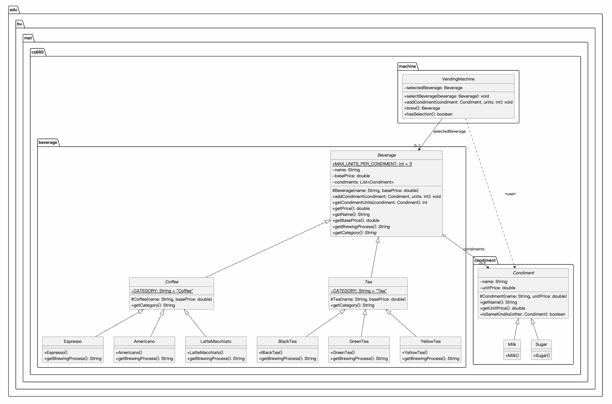

| CS-665       | Software Design & Patterns |
|--------------|----------------------------|
| Name         | Jiafu Guo                  |
| Date         | 10/06/2026                 |
| Course       | Fall 2026                  |
| Assignment # | 1                          |

# Assignment Overview

This project is the control software of a fully automatic beverage vending machine. The
machine prepares six drinks, three coffees (Espresso, Americano, Latte Macchiato) and
three teas (Black Tea, Green Tea, Yellow Tea), and lets the customer add two condiments,
milk and sugar, with 0 to 3 units of each per drink. The software also calculates the final
price of a drink from a base price plus a price per condiment unit (the optional task).

There is no graphical or command line user interface. The user interactions are implemented
as sequences of JUnit tests, as required by the assignment. `Main` only runs a short console
demo.

# GitHub Repository Link:
https://github.com/guojiafu-jeff/cs-665-assignment-1

# Implementation Description

## Design overview

The code is organized in three packages that mirror the three concepts of the problem:

| Package | Classes | Responsibility |
|---|---|---|
| `edu.bu.met.cs665.condiment` | `Condiment` (abstract), `Milk`, `Sugar` | A kind of condiment: its name and its price per unit. |
| `edu.bu.met.cs665.beverage` | `Beverage` (abstract), `Coffee` (abstract), `Tea` (abstract), `Espresso`, `Americano`, `LatteMacchiato`, `BlackTea`, `GreenTea`, `YellowTea` | A drink: name, base price, the condiments added to it, the 0-3 rule and the price calculation. |
| `edu.bu.met.cs665.machine` | `VendingMachine` | The control panel the user operates: select a beverage, add condiments, brew. |

All operations of the machine go through `VendingMachine`. The user only creates the drink
and condiment objects to say what they want (for example `new Espresso()`, `new Milk()`)
and reads the finished `Beverage` returned by `brew()`:


How the classes work together:

- `Beverage` is the abstract base of every drink. It stores the name, the base price and a
  list with one `Condiment` object per unit added. `addCondiment()` is the only place where
  the condiment rule is checked; `getPrice()` adds the unit price of every condiment in the
  list to the base price. `getBrewingProcess()` and `getCategory()` are abstract.
- `Coffee` and `Tea` are abstract category classes. They implement `getCategory()` once for
  all drinks of their category; a customer never orders "a coffee" in general.
- The six concrete drinks only supply their name, their base price and their brewing process.
- `Condiment` is the abstract base of `Milk` and `Sugar`. A `Condiment` object describes a
  kind of condiment (name, unit price); it does not store an amount. `isSameKindAs()` is used
  by `Beverage` to count the units of one kind.
- `VendingMachine` remembers the beverage of the current order, enforces the order of the
  operations (select, then add condiments, then brew) and resets itself after `brew()` so it
  is ready for the next customer. It works only with the abstract types `Beverage` and
  `Condiment`.

Invalid requests are reported with exceptions, so the caller cannot overlook them:
`IllegalArgumentException` for a bad argument (null, negative units, more than 3 units of a
condiment) and `IllegalStateException` for a wrong order of operations (adding a condiment or
brewing before a beverage is selected). A rejected request leaves the drink and the machine
unchanged, so the order can continue. The JUnit tests check these cases; `Main` shows how a
caller catches the exception and prints the message of the machine.

## Assumptions

1. The machine offers exactly six drinks: Espresso, Americano, Latte Macchiato, Black Tea,
   Green Tea and Yellow Tea.
2. Each drink has its own base price: Espresso \$2.00, Americano \$2.50, Latte Macchiato \$3.00,
   Black Tea \$1.50, Green Tea \$1.50, Yellow Tea \$2.00. Every condiment unit costs \$0.50.
3. The condiments are milk and sugar. A drink may contain 0 to 3 units of each, counted over
   all requests of an order and counted separately for each condiment, so a drink can have at
   most 3 + 3 = 6 units. A request that would exceed the limit is rejected with an exception
   and is not silently cut down to 3.
4. The machine handles one order at a time. After `brew()` it is reset for the next customer.
   Selecting a beverage again while an order is in progress replaces the previous choice,
   including the condiments already added to it.
5. Ingredients in the vending machine are considered unlimited (assume it's refilled by an operator).
6. There is no real hardware, so the brewing process of a drink is represented by a text
   description returned by `getBrewingProcess()`.

## Flexibility

- A new drink is one new subclass of `Coffee` or `Tea` with its name, base price and brewing
  process; no existing file changes. Removing a drink means deleting one file.
- A new condiment (for example oat milk) is one new subclass of `Condiment`; no existing file
  changes.
- A new category of drinks (for example hot chocolate) is one new subclass of `Beverage`.
- `VendingMachine` depends only on the abstract types `Beverage` and `Condiment`, so it never
  changes when drinks or condiments are added or removed.
- The condiment limit is a single constant, `Beverage.MAX_UNITS_PER_CONDIMENT`; prices are
  constants in the drink and condiment classes.

## Simplicity and understandability

- Three packages mirror the three concepts of the problem: condiment, beverage, machine.
- Each class has one job, and the class and method names read like the problem statement:
  `selectBeverage`, `addCondiment`, `brew`.
- The user-facing API is three methods on one class; the tests read like a customer using the
  machine.
- Every file and every method has a documentation comment that says what it does and where it
  is used.

## Avoiding duplicated code

- The condiment limit and the price formula exist once, in `Beverage`. `VendingMachine`
  delegates to the beverage instead of checking again, and every drink inherits the rule.
- Each concrete drink states its name and base price in exactly one place, its constructor;
  `Coffee` and `Tea` implement `getCategory()` once for all drinks of their category.
- The "same kind of condiment" comparison exists once, in `Condiment.isSameKindAs()`.
- In `VendingMachine`, the check that a beverage has been selected is one private method,
  `requireSelection()`, used by `addCondiment()` and `brew()`.

Why this matters: a rule that lives in one place can be changed in one place (for example a
new limit of 4 units), behaves the same everywhere, and has one place to test, which means
fewer bugs.

## Design patterns

No design pattern was applied in this assignment.

## Use of AI assistance

I used Claude to help me write PlantUML code to get a clear UML graph. It also helped me to format the readme file.

# UML Class Diagram



The same diagram as a PDF: [uml/UML.pdf](uml/UML.pdf).

# Maven Commands

We'll use Apache Maven to compile and run this project. You'll need to install Apache Maven (https://maven.apache.org/) on your system. 

Apache Maven is a build automation tool and a project management tool for Java-based projects. Maven provides a standardized way to build, package, and deploy Java applications.

Maven uses a Project Object Model (POM) file to manage the build process and its dependencies. The POM file contains information about the project, such as its dependencies, the build configuration, and the plugins used for building and packaging the project.

Maven provides a centralized repository for storing and accessing dependencies, which makes it easier to manage the dependencies of a project. It also provides a standardized way to build and deploy projects, which helps to ensure that builds are consistent and repeatable.

Maven also integrates with other development tools, such as IDEs and continuous integration systems, making it easier to use as part of a development workflow.

Maven provides a large number of plugins for various tasks, such as compiling code, running tests, generating reports, and creating JAR files. This makes it a versatile tool that can be used for many different types of Java projects.

## Compile
Type on the command line: 

```bash
mvn clean compile
```

## Run the demo
`Main` runs a short console demo (two customers, including a rejected 4th unit of sugar):

```bash
mvn compile exec:java
```

## JUnit Tests
JUnit is a popular testing framework for Java. JUnit tests are automated tests that are written to verify that the behavior of a piece of code is as expected.

In JUnit, tests are written as methods within a test class. Each test method tests a specific aspect of the code and is annotated with the @Test annotation. JUnit provides a range of assertions that can be used to verify the behavior of the code being tested.

JUnit tests are executed automatically and the results of the tests are reported. This allows developers to quickly and easily check if their code is working as expected, and make any necessary changes to fix any issues that are found.

The use of JUnit tests is an important part of Test-Driven Development (TDD), where tests are written before the code they are testing is written. This helps to ensure that the code is written in a way that is easily testable and that all required functionality is covered by tests.

JUnit tests can be run as part of a continuous integration pipeline, where tests are automatically run every time changes are made to the code. This helps to catch any issues as soon as they are introduced, reducing the need for manual testing and making it easier to ensure that the code is always in a releasable state.

To run, use the following command:
```bash
mvn clean test
```

The tests of this assignment are `src/test/java/edu/bu/met/cs665/TestBeverage.java` and
`src/test/java/edu/bu/met/cs665/TestVendingMachine.java`.

## Spotbugs 

SpotBugs is a static code analysis tool for Java that detects potential bugs in your code. It is an open-source tool that can be used as a standalone application or integrated into development tools such as Eclipse, IntelliJ, and Gradle.

SpotBugs performs an analysis of the bytecode generated from your Java source code and reports on any potential problems or issues that it finds. This includes things like null pointer exceptions, resource leaks, misused collections, and other common bugs.

The tool uses data flow analysis to examine the behavior of the code and detect issues that might not be immediately obvious from just reading the source code. SpotBugs is able to identify a wide range of issues and can be customized to meet the needs of your specific project.

Using SpotBugs can help to improve the quality and reliability of your code by catching potential bugs early in the development process. This can save time and effort in the long run by reducing the need for debugging and fixing issues later in the development cycle. SpotBugs can also help to ensure that your code is secure by identifying potential security vulnerabilities.

Use the following command:

```bash
mvn spotbugs:gui 
```

For more info see 
https://spotbugs.readthedocs.io/en/latest/maven.html

SpotBugs https://spotbugs.github.io/ is the spiritual successor of FindBugs.


## Checkstyle 

Checkstyle is a development tool for checking Java source code against a set of coding standards. It is an open-source tool that can be integrated into various integrated development environments (IDEs), such as Eclipse and IntelliJ, as well as build tools like Maven and Gradle.

Checkstyle performs static code analysis, which means it examines the source code without executing it, and reports on any issues or violations of the coding standards defined in its configuration. This includes issues like code style, code indentation, naming conventions, code structure, and many others.

By using Checkstyle, developers can ensure that their code adheres to a consistent style and follows best practices, making it easier for other developers to read and maintain. It can also help to identify potential issues before the code is actually run, reducing the risk of runtime errors or unexpected behavior.

Checkstyle is highly configurable and can be customized to fit the needs of your team or organization. It supports a wide range of coding standards and can be integrated with other tools, such as code coverage and automated testing tools, to create a comprehensive and automated software development process.

The following command will generate a report in HTML format that you can open in a web browser. 

```bash
mvn checkstyle:checkstyle
```

The HTML page will be found at the following location:
`target/site/checkstyle.html`
